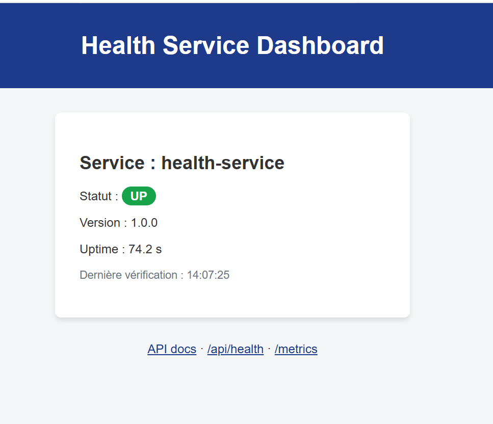
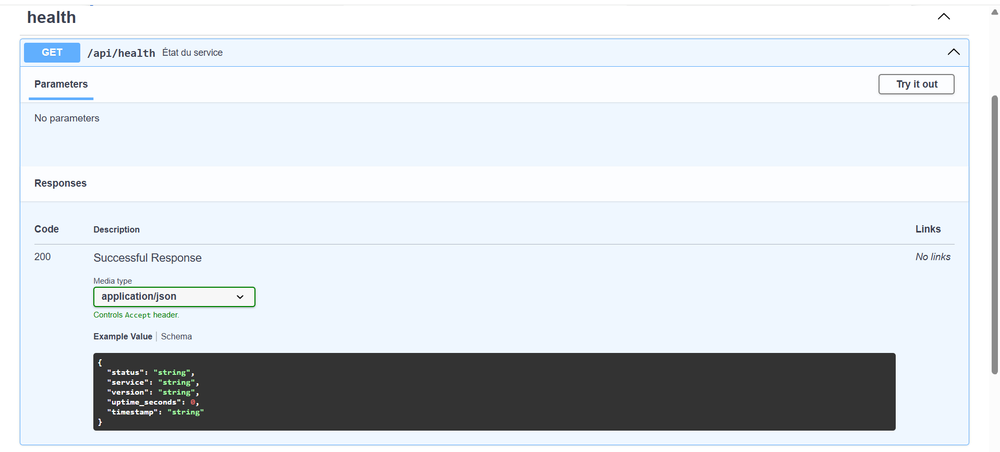
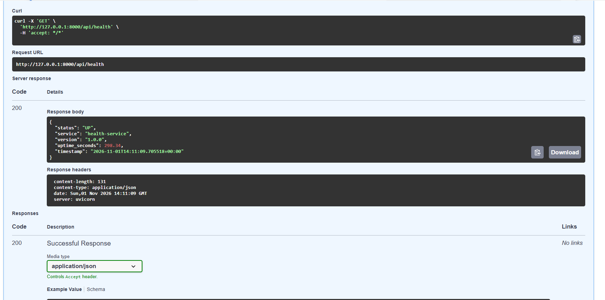
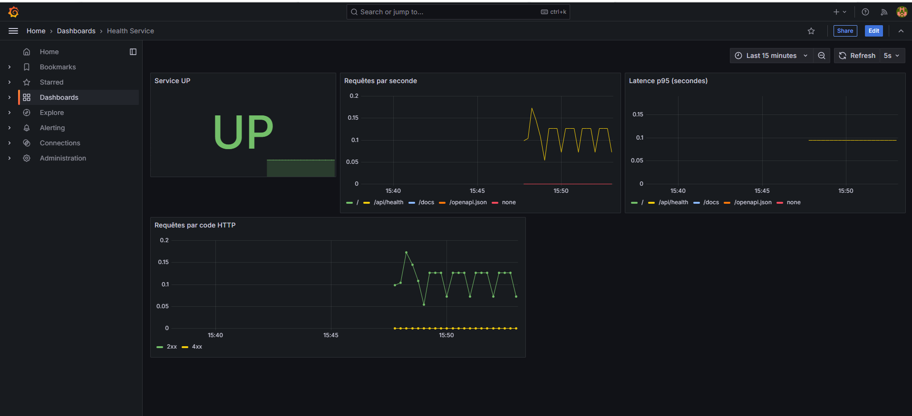
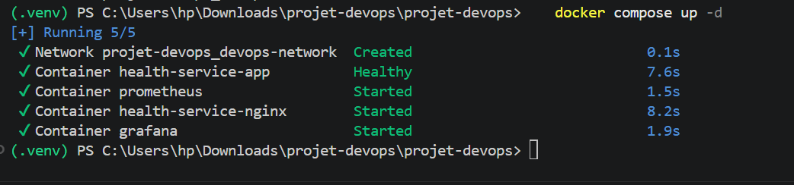
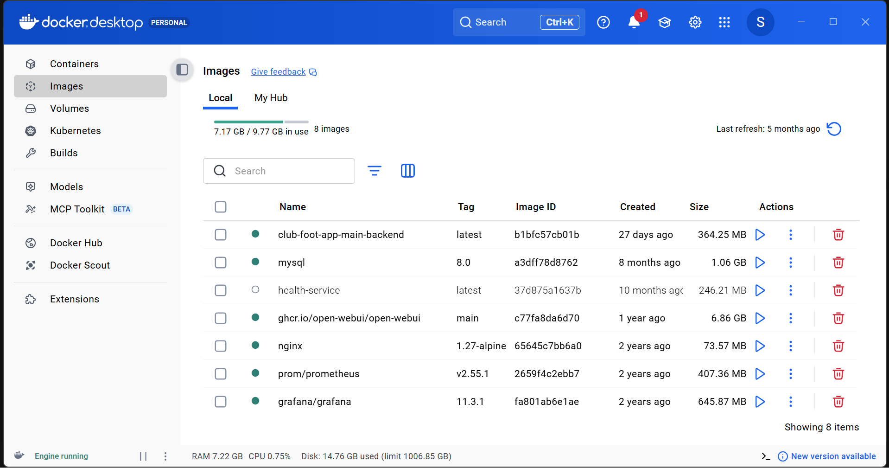
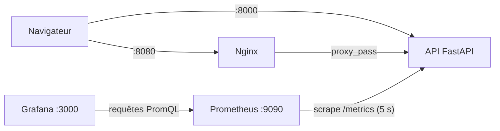
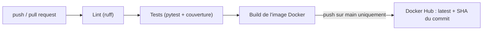

# Health Service – Projet DevOps

Microservice **FastAPI** de supervision, conteneurisé avec **Docker**, exposé derrière **Nginx**, monitoré par **Prometheus** et **Grafana**, et livré par un pipeline **GitHub Actions** (lint → tests → build → publication de l'image).


> 📄 Le **rapport technique détaillé** du projet est disponible ici : [docs/RAPPORT.md](docs/RAPPORT.md)

---

## Sommaire

1. [Aperçu](#aperçu)
2. [Fonctionnalités](#fonctionnalités)
3. [Architecture](#architecture)
4. [Stack technique](#stack-technique)
5. [Démarrage rapide](#démarrage-rapide)
6. [Endpoints et URLs](#endpoints-et-urls)
7. [Monitoring](#monitoring)
8. [Tests et qualité](#tests-et-qualité)
9. [CI/CD](#cicd)
10. [Configuration](#configuration)
11. [Structure du projet](#structure-du-projet)
12. [Dépannage](#dépannage)
13. [Pistes d'évolution](#pistes-dévolution)

---

## Aperçu

### Dashboard web

Page d'accueil qui affiche le statut, la version et l'uptime du service, et qui se rafraîchit automatiquement toutes les 5 secondes.



### Documentation interactive de l'API (Swagger)

Générée automatiquement par FastAPI à partir du code et des modèles de données.



Exécution de la route `GET /api/health` directement depuis Swagger :



### Monitoring avec Grafana

Dashboard provisionné automatiquement : état du service, requêtes par seconde, latence p95 et répartition par code HTTP.



### Stack Docker Compose

Démarrage des quatre services (API, Nginx, Prometheus, Grafana) : l'API passe à l'état `Healthy` grâce au healthcheck.



Images utilisées dans Docker Desktop (nginx, prom/prometheus et grafana/grafana font partie de cette stack ; les autres images appartiennent à d'autres projets) :



---

## Fonctionnalités

- **API de health-check** (`/api/health`) : statut, nom, version, uptime, horodatage UTC.
- **Dashboard web** avec rafraîchissement automatique.
- **Documentation OpenAPI / Swagger** générée automatiquement.
- **Métriques Prometheus** (`/metrics`) : nombre de requêtes, latences, codes HTTP.
- **Reverse proxy Nginx** devant l'API.
- **Grafana** préconfiguré (datasource et dashboard provisionnés par fichiers).
- **Pipeline CI/CD** : lint, tests avec couverture, build et publication de l'image Docker.
- **Mode développement** avec rechargement automatique du code dans le conteneur.

---

## Architecture



Tous les services partagent le réseau Docker `devops-network` et se joignent par leur **nom** (`app`, `prometheus`).

---

## Stack technique

| Domaine | Technologie | Version |
|---|---|---|
| Langage | Python | 3.12 |
| Framework web | FastAPI + Uvicorn | 0.162.0 / 0.54.0 |
| Templates | Jinja2 | 3.1.6 |
| Instrumentation | prometheus-fastapi-instrumentator | 8.1.0 |
| Tests | pytest, pytest-cov | 9.2.0 / 7.1.0 |
| Qualité de code | ruff | 0.17.3 |
| Conteneurs | Docker, Docker Compose | – |
| Reverse proxy | Nginx | 1.27-alpine |
| Monitoring | Prometheus / Grafana | 2.55.1 / 11.3.1 |
| CI/CD | GitHub Actions | – |

---

## Démarrage rapide

### Avec Docker (recommandé)

Prérequis : [Docker Desktop](https://www.docker.com/products/docker-desktop/) démarré.

```bash
git clone https://github.com/https://github.com/SIHAMCODE13/projet-devops.git
cd projet-devops
docker compose up --build
```

Pour lancer en arrière-plan : `docker compose up -d --build`.

Mode **production** (sans volume ni rechargement automatique) :

```bash
docker compose -f docker-compose.yml up -d --build
```

Arrêt : `docker compose down` (ajouter `-v` pour supprimer aussi les données Prometheus et Grafana).

### Sans Docker (Windows PowerShell)

```powershell
python -m venv .venv
.venv\Scripts\Activate.ps1
pip install -r requirements-dev.txt
uvicorn app.main:app --reload
```

Sous Linux / macOS : `source .venv/bin/activate` à la place de `Activate.ps1`.

> Dans ce mode, seule l'API tourne : Prometheus, Nginx et Grafana nécessitent Docker Compose.

---

## Endpoints et URLs

| Service | URL | Description |
|---|---|---|
| Dashboard | http://localhost:8000 | Page web de supervision |
| API health | http://localhost:8000/api/health | État du service (JSON) |
| Swagger | http://localhost:8000/docs | Documentation interactive |
| OpenAPI | http://localhost:8000/openapi.json | Spécification de l'API |
| Métriques | http://localhost:8000/metrics | Format Prometheus |
| Via Nginx | http://localhost:8080 | Même application derrière le reverse proxy |
| Prometheus | http://localhost:9090 | Interface de requêtes et cibles |
| Grafana | http://localhost:3000 | Identifiants par défaut : `admin` / `admin` |

Exemple de réponse de `GET /api/health` :

```json
{
  "status": "UP",
  "service": "health-service",
  "version": "1.0.0",
  "uptime_seconds": 298.34,
  "timestamp": "2026-11-01T14:11:09.705518+00:00"
}
```

---

## Monitoring

1. **Prometheus** interroge `app:8000/metrics` toutes les 5 secondes. Vérifier la cible dans **Status → Targets** (`health-service` doit être `UP`).
2. Requêtes utiles dans l'onglet **Graph** :
   ```promql
   http_requests_total
   sum(rate(http_requests_total[1m])) by (handler)
   histogram_quantile(0.95, sum(rate(http_request_duration_seconds_bucket[1m])) by (le, handler))
   ```
3. **Grafana** : *Dashboards → Health Service*. Le dashboard contient quatre panneaux : état du service, requêtes par seconde, latence p95, requêtes par code HTTP. Les courbes se remplissent dès qu'il y a du trafic (rafraîchir le dashboard de l'application suffit).

---

## Tests et qualité

```bash
python -m pytest --cov=app     # 5 tests + rapport de couverture
ruff check .                   # analyse statique
ruff format .                  # formatage
```

Les tests couvrent : l'endpoint de santé, la page dashboard, les fichiers statiques, les métriques et le cas 404. Couverture actuelle : **100 %** du dossier `app/`.

---

## CI/CD

Workflow : [`.github/workflows/ci-cd.yml`](.github/workflows/ci-cd.yml), déclenché sur chaque `push` et `pull request` vers `main`.



- Sur une **pull request** : l'image est construite mais **jamais publiée**.
- Sur un **push vers `main`** : l'image est publiée avec deux tags (`latest` et le SHA du commit).

Secrets à créer dans *Settings → Secrets and variables → Actions* :

| Secret | Contenu |
|---|---|
| `DOCKER_USERNAME` | Nom d'utilisateur Docker Hub |
| `DOCKER_PASSWORD` | Token d'accès Docker Hub (pas le mot de passe du compte) |

---

## Configuration

Les variables se définissent dans un fichier `.env` (modèle : `.env.example`, le `.env` n'est pas versionné).

| Variable | Défaut | Rôle |
|---|---|---|
| `SERVICE_NAME` | `health-service` | Nom affiché par l'API et le dashboard |
| `SERVICE_VERSION` | `1.0.0` | Version affichée |
| `GRAFANA_USER` | `admin` | Utilisateur Grafana |
| `GRAFANA_PASSWORD` | `admin` | Mot de passe Grafana (à changer hors usage local) |

---

## Structure du projet

```
.
├── app/
│   ├── main.py                   # création de l'app, routes, monitoring
│   ├── config.py                 # variables d'environnement
│   ├── routers/health.py         # route /api/health
│   ├── services/health_service.py# logique métier
│   ├── static/                   # CSS, JavaScript
│   └── templates/index.html      # page du dashboard
├── tests/test_health.py          # tests pytest
├── nginx/default.conf            # configuration du reverse proxy
├── monitoring/grafana/           # datasource + dashboard provisionnés
├── prometheus.yml                # configuration de la collecte
├── Dockerfile                    # image (utilisateur non-root + healthcheck)
├── docker-compose.yml            # stack complète
├── docker-compose.override.yml   # surcharge de développement
├── requirements.txt              # dépendances de production
├── requirements-dev.txt          # dépendances de test et de lint
├── .github/workflows/ci-cd.yml   # pipeline CI/CD
└── docs/                         # rapport technique et captures d'écran
```

---

## Dépannage

**`port is already allocated` / `ports are not available`**
Un autre programme utilise déjà le port. Identifier l'occupant :
```powershell
docker ps
netstat -ano | findstr :8080
```
Puis changer le premier nombre du mapping dans `docker-compose.yml` (par exemple `"8081:80"` pour Nginx, `"3001:3000"` pour Grafana). Les conteneurs continuent à communiquer entre eux sur leurs ports internes.

**`pull access denied for health-service-app`**
Simple avertissement : Compose tente d'abord de télécharger l'image, puis la construit localement.

**Le disque C: se remplit (Windows)**
Docker Desktop stocke tout dans un disque virtuel qui ne rétrécit pas tout seul. Voir `docker system df`, puis `docker builder prune` et `docker system prune`.

**Scripts `.sh` qui échouent (`exec format error`)**
Problème de fins de ligne Windows (CRLF). Le fichier `.gitattributes` force le format LF pour ces fichiers.

---

## Pistes d'évolution

- Déploiement automatique sur une VM ou un service cloud (Terraform, Ansible).
- HTTPS dans Nginx (certificats Let's Encrypt).
- Alertes avec Alertmanager (service indisponible, latence élevée).
- Scan de sécurité de l'image (Trivy) dans la CI.
- Contrôles de santé enrichis (dépendances, endpoint de readiness distinct).

---

## Auteur

**Siham Talbi** – projet réalisé dans le cadre d'un apprentissage DevOps.
