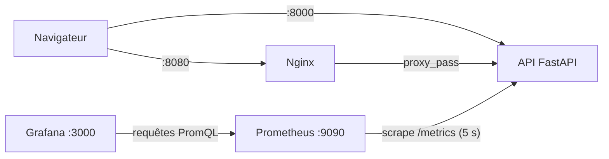
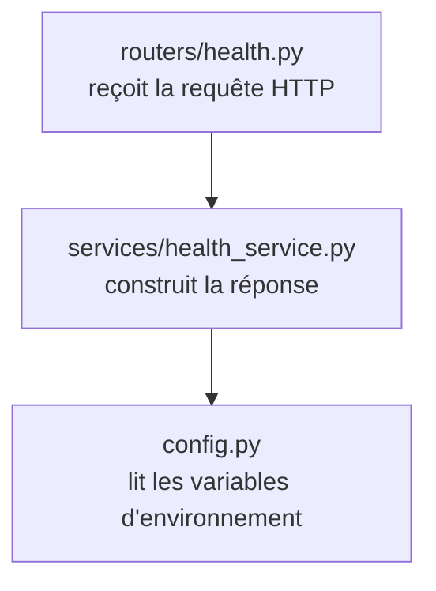
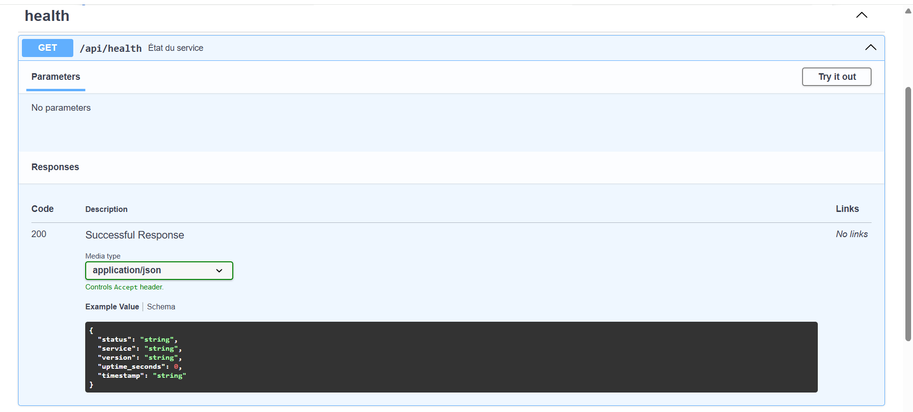
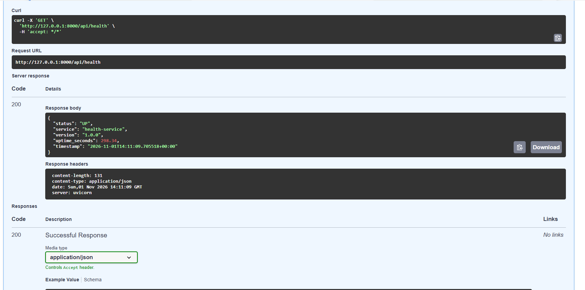
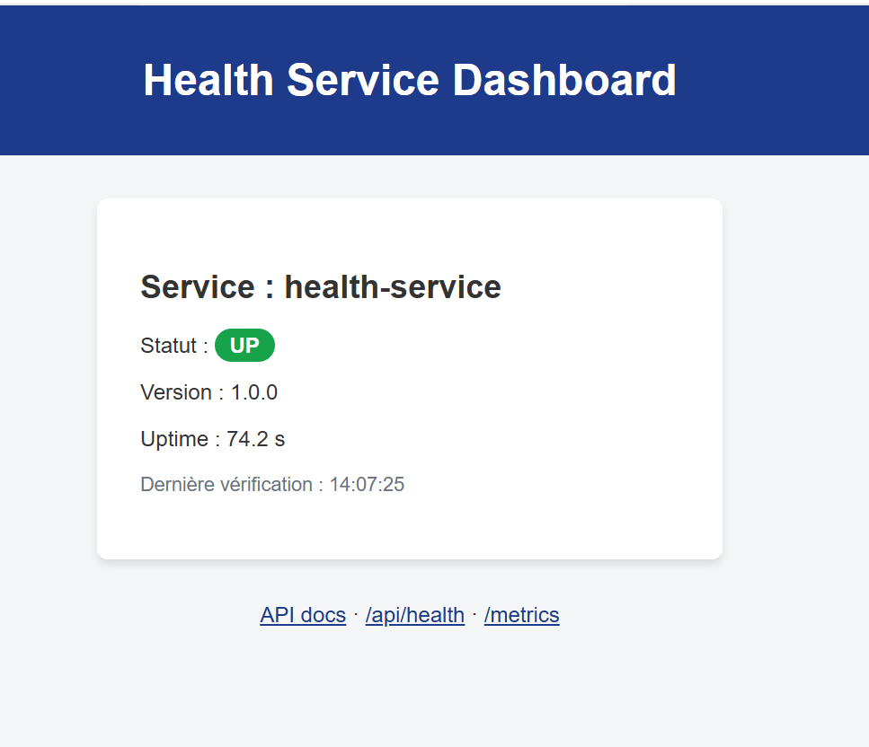
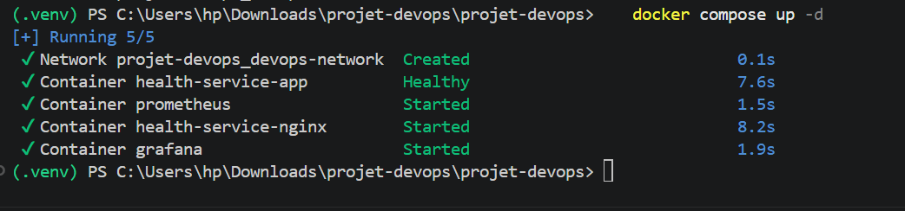
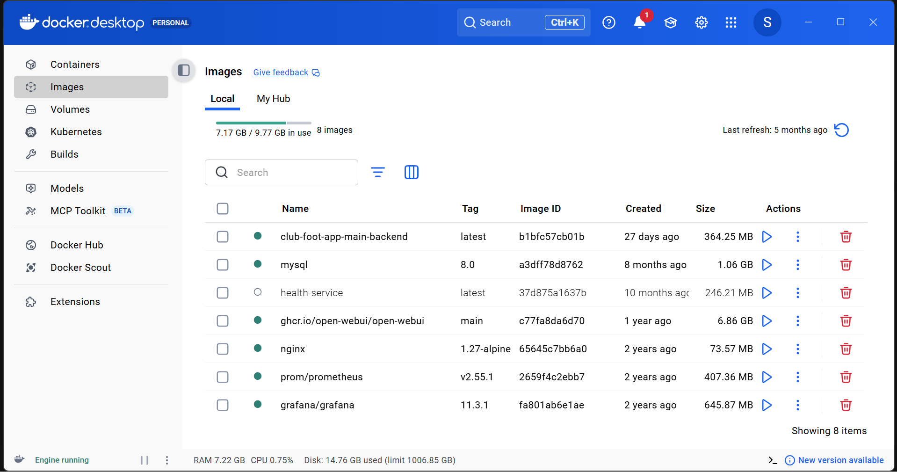
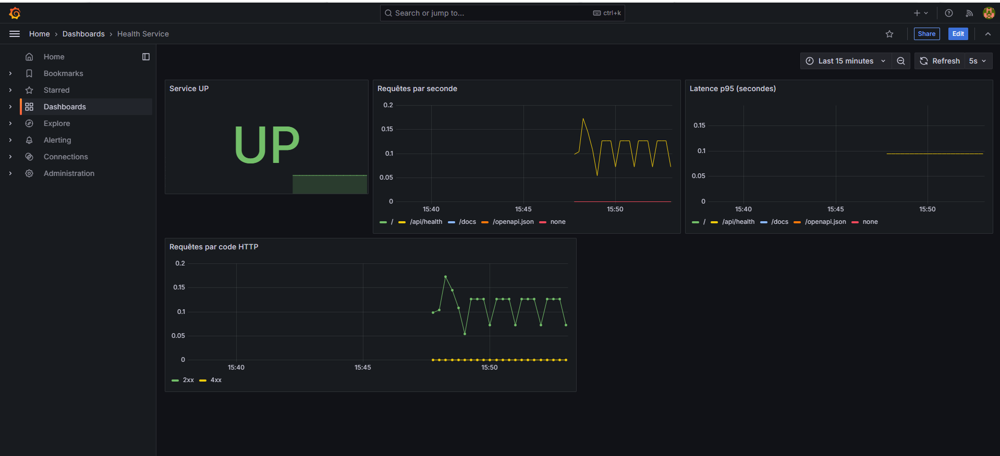
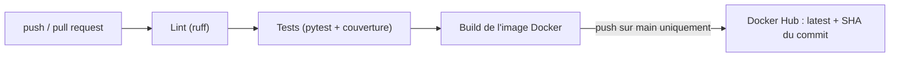

# Rapport technique – Health Service

### Conception et mise en œuvre d'une chaîne DevOps complète autour d'un microservice FastAPI

| | |
|---|---|
| **Auteur** | [Votre nom] |
| **Date** | 1er novembre 2026 |
| **Version du document** | 1.0 |
| **Dépôt** | [lien du dépôt GitHub] |

---

## Table des matières

1. [Résumé](#1-résumé)
2. [Contexte et objectifs](#2-contexte-et-objectifs)
3. [Présentation de la solution](#3-présentation-de-la-solution)
4. [Architecture](#4-architecture)
5. [Choix technologiques](#5-choix-technologiques)
6. [L'application](#6-lapplication)
7. [Conteneurisation](#7-conteneurisation)
8. [Orchestration avec Docker Compose](#8-orchestration-avec-docker-compose)
9. [Reverse proxy Nginx](#9-reverse-proxy-nginx)
10. [Monitoring : Prometheus et Grafana](#10-monitoring--prometheus-et-grafana)
11. [Tests et qualité du code](#11-tests-et-qualité-du-code)
12. [Intégration et livraison continues](#12-intégration-et-livraison-continues)
13. [Mise en œuvre et résultats](#13-mise-en-œuvre-et-résultats)
14. [Difficultés rencontrées et solutions](#14-difficultés-rencontrées-et-solutions)
15. [Sécurité et bonnes pratiques](#15-sécurité-et-bonnes-pratiques)
16. [Limites et perspectives](#16-limites-et-perspectives)
17. [Conclusion](#17-conclusion)
18. [Annexes](#18-annexes)

---

## 1. Résumé

Ce projet met en place, autour d'un microservice de supervision écrit avec **FastAPI**, l'ensemble des briques d'une chaîne **DevOps** moderne :

- conteneurisation de l'application avec **Docker** ;
- orchestration de quatre services avec **Docker Compose** (API, Nginx, Prometheus, Grafana) ;
- supervision par **Prometheus** et visualisation par **Grafana** ;
- automatisation des contrôles qualité, des tests et de la construction de l'image par un pipeline **GitHub Actions**.

L'application elle-même est volontairement simple (un endpoint de health-check et un dashboard web) afin de concentrer l'effort sur l'**industrialisation** : reproductibilité des environnements, automatisation, observabilité et sécurité de base.

---

## 2. Contexte et objectifs

### 2.1 Contexte

Un service en production doit pouvoir répondre à des questions simples : *est-il vivant ? Quelle version tourne ? Combien de requêtes reçoit-il et avec quelle latence ?* Ce projet construit l'infrastructure qui permet d'y répondre de façon automatique, et de livrer chaque modification de façon fiable.

### 2.2 Objectifs

| # | Objectif | Réalisation |
|---|---|---|
| 1 | Exposer l'état d'un service via une API REST | Endpoint `/api/health` et documentation OpenAPI |
| 2 | Rendre l'exécution reproductible | Image Docker et stack Docker Compose |
| 3 | Rendre le service observable | Métriques Prometheus et dashboard Grafana |
| 4 | Automatiser la qualité et la livraison | Pipeline GitHub Actions (lint, tests, build, publication) |
| 5 | Appliquer des bonnes pratiques de sécurité | Utilisateur non-root, healthcheck, secrets externalisés, versions fixées |

---

## 3. Présentation de la solution

Le système est composé de quatre services conteneurisés et d'un pipeline d'intégration continue.

| Service | Rôle |
|---|---|
| **API FastAPI** | Expose `/api/health`, le dashboard web, la documentation Swagger et les métriques `/metrics` |
| **Nginx** | Reverse proxy : point d'entrée devant l'API |
| **Prometheus** | Collecte et stocke les métriques de l'API toutes les 5 secondes |
| **Grafana** | Affiche les métriques sous forme de graphiques |

---

## 4. Architecture

### 4.1 Vue d'ensemble



Les services communiquent sur un réseau Docker dédié, `devops-network`. Ils se trouvent par **nom de service** (`app`, `prometheus`) grâce au DNS interne de Docker, sans adresse IP codée en dur.

### 4.2 Flux d'une métrique

1. Un utilisateur appelle une route de l'API.
2. L'instrumentation incrémente le compteur `http_requests_total` et enregistre la durée dans l'histogramme `http_request_duration_seconds`.
3. Toutes les 5 secondes, Prometheus lit la page `/metrics` (modèle **pull**).
4. Grafana interroge Prometheus en PromQL, par exemple pour calculer le 95ᵉ centile de latence.

### 4.3 Architecture logicielle de l'application



Chaque couche a une responsabilité unique, ce qui facilite les tests et les évolutions.

---

## 5. Choix technologiques

| Technologie | Version | Justification |
|---|---|---|
| Python | 3.12 | Langage lisible, écosystème web mature |
| FastAPI | 0.162.0 | Performances, validation de données, documentation OpenAPI automatique |
| Uvicorn | 0.54.0 | Serveur ASGI de référence pour FastAPI |
| Jinja2 | 3.1.6 | Moteur de templates pour le dashboard |
| prometheus-fastapi-instrumentator | 8.1.0 | Instrumentation HTTP sans code de mesure à écrire |
| Docker / Compose | – | Environnements reproductibles, démarrage en une commande |
| Nginx | 1.27-alpine | Reverse proxy léger et répandu |
| Prometheus | 2.55.1 | Standard de fait pour les métriques des systèmes conteneurisés |
| Grafana | 11.3.1 | Visualisation, provisionnement par fichiers |
| GitHub Actions | – | CI/CD intégrée au dépôt |
| pytest, pytest-cov | 9.2.0 / 7.1.0 | Tests et mesure de couverture |
| ruff | 0.17.3 | Lint et formatage rapides |

Les versions sont **fixées** (et non « dernière version ») afin que chaque construction produise le même résultat, aujourd'hui comme dans plusieurs mois.

---

## 6. L'application

### 6.1 Structure

```
app/
├── main.py                    # création de l'application, routes, monitoring
├── config.py                  # variables d'environnement
├── routers/health.py          # route /api/health
├── services/health_service.py # logique métier
├── static/                    # CSS et JavaScript
└── templates/index.html       # page du dashboard
```

### 6.2 Endpoints

| Méthode | Route | Description |
|---|---|---|
| GET | `/` | Dashboard web |
| GET | `/api/health` | État du service au format JSON |
| GET | `/docs` | Documentation Swagger interactive |
| GET | `/openapi.json` | Spécification OpenAPI |
| GET | `/metrics` | Métriques au format Prometheus |
| GET | `/static/...` | Fichiers CSS et JavaScript |

### 6.3 Endpoint de santé

Réponse de `GET /api/health` :

```json
{
  "status": "UP",
  "service": "health-service",
  "version": "1.0.0",
  "uptime_seconds": 298.34,
  "timestamp": "2026-11-01T14:11:09.705518+00:00"
}
```

Le modèle de réponse est déclaré avec Pydantic (`HealthResponse`), ce qui garantit la forme de la réponse et alimente automatiquement la documentation.

### 6.4 Documentation automatique (Swagger)

FastAPI génère la spécification OpenAPI à partir du code. La page `/docs` liste la route, son résumé, les paramètres, les codes de réponse et le schéma de données.


*Figure 1 – Documentation Swagger de la route `GET /api/health`.*

Le bouton « Try it out » permet d'exécuter la route depuis le navigateur et de voir la requête `curl` équivalente, la réponse et les en-têtes.


*Figure 2 – Exécution de `GET /api/health` : code 200, corps JSON et en-têtes de réponse.*

### 6.5 Dashboard web

La page d'accueil présente le nom du service, son statut, sa version et son uptime. Un script JavaScript appelle `/api/health` toutes les 5 secondes et met à jour l'affichage ; en cas d'échec de l'appel, le statut passe automatiquement à **DOWN** en rouge.


*Figure 3 – Dashboard du service : statut UP, version, uptime et heure de la dernière vérification.*

### 6.6 Configuration

La configuration est lue depuis les **variables d'environnement** (principe *12-factor*). Le même code s'exécute donc en local, en test et en conteneur sans modification.

| Variable | Défaut | Rôle |
|---|---|---|
| `SERVICE_NAME` | `health-service` | Nom affiché |
| `SERVICE_VERSION` | `1.0.0` | Version affichée |

### 6.7 Choix de conception

- **Chemins absolus** (`Path(__file__)`) pour les fichiers statiques et les templates : l'application fonctionne quel que soit le dossier de lancement.
- **Chemins relatifs dans le HTML** (`/static/css/style.css`) : évite des URLs absolues erronées derrière un reverse proxy.
- **Exclusion de `/metrics` et `/static`** de l'instrumentation pour ne pas polluer les statistiques avec le trafic de supervision.

---

## 7. Conteneurisation

### 7.1 Dockerfile

| Instruction | Objectif |
|---|---|
| `FROM python:3.12-slim` | Image de base légère |
| `ENV PYTHONDONTWRITEBYTECODE=1 PYTHONUNBUFFERED=1` | Pas de fichiers `.pyc`, logs affichés immédiatement |
| `COPY requirements.txt` puis `pip install` | Les dépendances sont installées **avant** la copie du code : la couche reste en cache tant que `requirements.txt` ne change pas |
| `COPY app ./app` | Seul le code utile est copié |
| `useradd` + `USER appuser` | Exécution avec un utilisateur **non-root** |
| `HEALTHCHECK` | Vérifie toutes les 15 s que `/api/health` répond (délai 3 s, 3 essais, 5 s de démarrage) |
| `CMD uvicorn ...` | Démarrage du serveur sur le port 8000 |

### 7.2 Fichier `.dockerignore`

Exclut du contexte de construction le dépôt Git, les tests, les caches Python, les fichiers de configuration de la stack et le fichier `.env`. L'image reste petite et ne contient aucun secret.

---

## 8. Orchestration avec Docker Compose

### 8.1 Services

| Service | Image | Port hôte → conteneur | Particularités |
|---|---|---|---|
| `app` | construite localement (`health-service-app:local`) | 8000 → 8000 | Healthcheck, `restart: unless-stopped` |
| `nginx` | `nginx:1.27-alpine` | 8080 → 80 | Démarre quand `app` est **healthy** |
| `prometheus` | `prom/prometheus:v2.55.1` | 9090 → 9090 | Volume de données persistant |
| `grafana` | `grafana/grafana:11.3.1` | 3000 → 3000 | Provisionnement automatique, volume persistant |

### 8.2 Points notables

- **Dépendances conditionnelles** : `depends_on` avec `condition: service_healthy` garantit que Nginx ne démarre pas devant une API qui n'est pas prête.
- **Variables avec valeurs par défaut** (`${SERVICE_NAME:-health-service}`) : le projet démarre même sans fichier `.env`.
- **Volumes nommés** (`prometheus-data`, `grafana-data`) : les données survivent à un redémarrage.
- **Réseau dédié** `devops-network` : isolation de la stack.

### 8.3 Deux modes d'exécution

| Mode | Commande | Comportement |
|---|---|---|
| Développement | `docker compose up --build` | Charge automatiquement `docker-compose.override.yml` : code monté en volume et rechargement automatique d'Uvicorn à chaque modification |
| Production | `docker compose -f docker-compose.yml up -d --build` | Image figée, sans volume ni rechargement |

Le fichier de base reste proche de la production ; seule la surcharge ajoute le confort de développement.

### 8.4 Démarrage de la stack


*Figure 4 – `docker compose up -d` : réseau créé, API `Healthy`, puis démarrage de Prometheus, Nginx et Grafana.*

L'état **Healthy** de `health-service-app` provient du healthcheck défini dans le Dockerfile : Compose attend ce signal avant de lancer Nginx.


*Figure 5 – Images présentes dans Docker Desktop. `nginx` (1.27-alpine), `prom/prometheus` (v2.55.1) et `grafana/grafana` (11.3.1) appartiennent à la stack ; les autres images sont celles d'autres projets de la machine.*

---

## 9. Reverse proxy Nginx

Nginx reçoit les requêtes sur le port 80 du conteneur (8080 sur l'hôte) et les transmet à l'API.

```nginx
server {
    listen 80;
    server_name _;

    location / {
        proxy_pass http://app:8000;
        proxy_http_version 1.1;
        proxy_set_header Host $http_host;
        proxy_set_header X-Real-IP $remote_addr;
        proxy_set_header X-Forwarded-For $proxy_add_x_forwarded_for;
        proxy_set_header X-Forwarded-Proto $scheme;
    }
}
```

| En-tête | Utilité |
|---|---|
| `Host` | Conserve l'hôte **et le port** demandés par le client |
| `X-Real-IP`, `X-Forwarded-For` | Transmettent l'adresse IP réelle du client à l'application |
| `X-Forwarded-Proto` | Indique si la requête d'origine était en HTTP ou HTTPS |

Ce composant constitue le point d'entrée naturel pour ajouter ensuite HTTPS, la limitation de débit ou la répartition de charge.

---

## 10. Monitoring : Prometheus et Grafana

### 10.1 Prometheus

Configuration (`prometheus.yml`) :

| Paramètre | Valeur |
|---|---|
| Intervalle de collecte | 5 s |
| Job `health-service` | cible `app:8000`, chemin `/metrics` |
| Job `prometheus` | Prometheus se supervise lui-même |
| Rétention des données | 15 jours (valeur par défaut) |

Principales métriques exposées par l'application :

| Métrique | Type | Signification |
|---|---|---|
| `http_requests_total` | Counter | Nombre de requêtes, par route, méthode et code de statut |
| `http_request_duration_seconds` | Histogram | Durée des requêtes, par route |
| `up` | Gauge | Prometheus arrive-t-il à joindre la cible (1) ou non (0) |

Le modèle **pull** présente un avantage : si le service disparaît, Prometheus le détecte (`up == 0`) sans que le service ait besoin de signaler sa propre panne.

### 10.2 Grafana

La datasource Prometheus et le dashboard sont **provisionnés par fichiers** (`monitoring/grafana/`) : à chaque création du conteneur, tout est déjà configuré, sans manipulation manuelle, ce qui rend l'installation reproductible.

| Panneau | Requête PromQL | Intérêt |
|---|---|---|
| Service UP | `up{job="health-service"}` | État de disponibilité |
| Requêtes par seconde | `sum(rate(http_requests_total[1m])) by (handler)` | Charge par route |
| Latence p95 | `histogram_quantile(0.95, sum(rate(http_request_duration_seconds_bucket[1m])) by (le, handler))` | Qualité de service perçue |
| Requêtes par code HTTP | `sum(rate(http_requests_total[1m])) by (status)` | Part des succès (2xx) et des erreurs (4xx, 5xx) |


*Figure 6 – Dashboard Grafana « Health Service » avec rafraîchissement toutes les 5 secondes.*

**Lecture du dashboard :**

- Le panneau **Service UP** affiche l'état `UP` : Prometheus joint bien l'API.
- Les **requêtes par seconde** montrent un trafic régulier sur `/api/health` : c'est le dashboard web qui interroge l'API toutes les 5 secondes. Les autres routes (`/`, `/docs`, `/openapi.json`) apparaissent lors des consultations ponctuelles.
- La **latence p95** reste autour de 0,1 s. La précision de cette valeur dépend des intervalles de l'histogramme dont le premier est à 0,1 s : il faut la lire comme « inférieure ou égale à environ 0,1 s ».
- Le graphique **par code HTTP** montre une très grande majorité de réponses 2xx ; la série 4xx reste quasi nulle (404 occasionnels, comme la recherche automatique de l'icône du site par le navigateur).

---

## 11. Tests et qualité du code

### 11.1 Tests automatisés

Cinq tests pytest utilisant le `TestClient` de FastAPI (aucun serveur réel nécessaire) :

| Test | Vérifie |
|---|---|
| `test_health_endpoint` | Code 200, statut `UP`, présence de tous les champs |
| `test_dashboard_page` | La page d'accueil est servie en HTML |
| `test_static_files_are_served` | Le CSS et le JavaScript sont accessibles |
| `test_metrics_endpoint` | `/metrics` expose `http_requests_total` |
| `test_unknown_route_returns_404` | Une route inconnue renvoie 404 |

**Couverture : 100 %** des lignes du dossier `app/`.

```bash
python -m pytest --cov=app
```

### 11.2 Analyse statique

**ruff** vérifie les erreurs de syntaxe, les imports, les bugs courants, les règles de style et la modernité du code (règles `E`, `F`, `I`, `W`, `B`, `UP`), avec une longueur de ligne de 100 caractères.

```bash
ruff check .
ruff format --check .
```

### 11.3 Vérification du fonctionnement réel

En plus des tests, le serveur a été lancé depuis un dossier différent de celui du projet, puis chaque route a été appelée : API, dashboard, fichiers statiques, documentation et métriques. Cette vérification a validé la robustesse des chemins absolus.

---

## 12. Intégration et livraison continues

### 12.1 Pipeline

Fichier : `.github/workflows/ci-cd.yml`, déclenché à chaque `push` et `pull request` vers `main`.



| Job | Étapes |
|---|---|
| `build-and-test` | Récupération du code, Python 3.12 avec cache pip, installation, ruff, pytest avec couverture |
| `docker` | Buildx, construction de l'image ; connexion à Docker Hub et publication **uniquement** lors d'un push sur `main` |

### 12.2 Choix importants

- Le job `docker` dépend du job de tests (`needs`) : une image n'est jamais construite à partir d'un code qui échoue aux tests.
- **Pas de publication sur une pull request** : on ne diffuse pas du code non relu, et les secrets ne sont de toute façon pas disponibles pour les contributions externes.
- **Deux tags** : `latest` pour la dernière version, et le **SHA du commit** pour retrouver précisément quel code correspond à quelle image.
- Les identifiants Docker Hub sont des **secrets GitHub** (`DOCKER_USERNAME`, `DOCKER_PASSWORD`), jamais écrits dans le dépôt.
- Le cache de construction GitHub (`type=gha`) accélère les exécutions suivantes.

### 12.3 Périmètre

Le pipeline couvre l'intégration continue complète et la livraison jusqu'au **registre d'images**. Le déploiement automatique sur un serveur n'est pas encore en place (voir section 16).

---

## 13. Mise en œuvre et résultats

### 13.1 Procédure

```bash
git clone <url-du-depot>
cd <dossier>
docker compose up --build
```

### 13.2 Résultats observés

| Vérification | Résultat |
|---|---|
| Construction de l'image | Réussie |
| Démarrage des 4 services | Réussi, API en état `Healthy` (Figure 4) |
| Endpoint `/api/health` | 200 avec JSON conforme (Figure 2) |
| Dashboard web | Affichage et rafraîchissement automatique (Figure 3) |
| Documentation Swagger | Générée et exécutable (Figures 1 et 2) |
| Collecte par Prometheus | Appels `GET /metrics` réguliers visibles dans les logs de l'API |
| Dashboard Grafana | Quatre panneaux alimentés (Figure 6) |
| Tests automatisés | 5/5 réussis, 100 % de couverture |

### 13.3 URLs d'accès

| Service | URL |
|---|---|
| Dashboard | http://localhost:8000 |
| Swagger | http://localhost:8000/docs |
| Via Nginx | http://localhost:8080 |
| Prometheus | http://localhost:9090 |
| Grafana | http://localhost:3000 |

---

## 14. Difficultés rencontrées et solutions

| Difficulté | Cause | Solution |
|---|---|---|
| Fichiers statiques et templates introuvables selon le dossier de lancement | Chemins relatifs (`"app/static"`) dépendant du dossier courant | Chemins absolus calculés avec `Path(__file__)` |
| Couches de code inutilisées (routeur, service, configuration) | L'endpoint était défini directement dans `main.py` avec des valeurs écrites en dur | Branchement du routeur avec le préfixe `/api` ; la logique passe par le service et la configuration |
| CSS non chargé derrière Nginx | `url_for` génère des URLs absolues, et l'en-tête `Host $host` perd le numéro de port | Chemins relatifs dans le HTML et en-tête `Host $http_host` |
| Nginx inopérant | Le nom d'hôte du proxy ne correspondait à aucun service Compose | Service Compose nommé `app`, cohérent avec `proxy_pass http://app:8000` |
| Publication Docker Hub sur chaque pull request | Absence de condition sur l'étape de push | Publication limitée aux push sur `main` |
| Conflits de ports (3000 et 8080) à l'exécution | Ports déjà utilisés par d'autres applications de la machine | Modification du port côté hôte dans `docker-compose.yml` ; le port interne ne change pas |
| Avertissement `pull access denied` au démarrage | Compose tente de télécharger l'image locale avant de la construire | Sans conséquence : l'image est ensuite construite localement |
| Occupation importante du disque système | Le stockage Docker Desktop (images, cache de build) croît sans se réduire seul | `docker system df`, `docker builder prune`, `docker system prune`, puis compactage du disque virtuel |
| Fins de ligne Windows (CRLF) dans les scripts shell | Conversion automatique de Git sous Windows | `.gitattributes` forçant le format LF pour les scripts |

---

## 15. Sécurité et bonnes pratiques

| Pratique | Mise en œuvre |
|---|---|
| Moindre privilège | Conteneur exécuté par un utilisateur non-root |
| Surface réduite | Image `slim`, `.dockerignore`, seul le code utile copié |
| Pas de secret dans le code | Identifiants Docker Hub dans les secrets GitHub, `.env` exclu de Git |
| Reproductibilité | Versions des dépendances et des images fixées |
| Santé des services | Healthcheck Docker et dépendance conditionnelle |
| Résilience | Politique de redémarrage `unless-stopped` |
| Traçabilité | Images taguées avec le SHA du commit |
| Isolation | Réseau Docker dédié |
| Publication maîtrisée | Image publiée uniquement depuis `main` |

**Points de vigilance connus :** le mot de passe Grafana par défaut (`admin` / `admin`) ne convient qu'à un usage local ; Nginx sert en HTTP ; aucun scan de vulnérabilités n'est encore intégré.

---

## 16. Limites et perspectives

### 16.1 Limites actuelles

- Pas de **déploiement automatique** sur un serveur : la livraison s'arrête au registre d'images.
- Pas d'**alertes** : les anomalies sont visibles, mais personne n'est notifié.
- **HTTP** uniquement.
- Le health-check est volontairement simple : il ne vérifie aucune dépendance (base de données, service tiers) et il n'y a pas de distinction entre *liveness* et *readiness*.
- Aucun scan de sécurité de l'image.

### 16.2 Évolutions envisagées

| Priorité | Évolution | Bénéfice |
|---|---|---|
| 1 | Déploiement continu sur une VM ou un service cloud (Terraform, Ansible) | Boucler la chaîne CI/CD |
| 2 | Alertmanager (service indisponible, latence élevée) | Réaction proactive |
| 3 | Scan Trivy dans la CI | Détection de vulnérabilités |
| 4 | HTTPS avec Let's Encrypt dans Nginx | Chiffrement des échanges |
| 5 | Endpoint de readiness et vérification de dépendances | Supervision plus fine |
| 6 | Journalisation centralisée (Loki) | Logs corrélés aux métriques |
| 7 | Migration vers Kubernetes | Orchestration à plus grande échelle |

---

## 17. Conclusion

Ce projet réalise une chaîne DevOps cohérente et fonctionnelle, du code à l'observabilité : une application testée et documentée, empaquetée dans une image sécurisée, déployée en une commande avec sa supervision, et validée à chaque modification par un pipeline automatisé.

Il m'a permis de mettre en pratique et de relier les notions de conteneurisation, d'orchestration, de supervision, d'intégration continue et de bonnes pratiques de sécurité, ainsi que de diagnostiquer des problèmes concrets (chemins, proxy, ports, stockage). Les limites identifiées, en particulier le déploiement automatique et l'alerting, constituent les prochaines étapes naturelles pour rapprocher la solution d'un contexte de production.

---

## 18. Annexes

### Annexe A – Arborescence du projet

```
.
├── app/
│   ├── __init__.py
│   ├── main.py
│   ├── config.py
│   ├── routers/health.py
│   ├── services/health_service.py
│   ├── static/css/style.css
│   ├── static/js/script.js
│   └── templates/index.html
├── tests/test_health.py
├── nginx/default.conf
├── monitoring/grafana/
│   ├── provisioning/datasources/prometheus.yml
│   ├── provisioning/dashboards/dashboards.yml
│   └── dashboards/health-service.json
├── prometheus.yml
├── Dockerfile
├── .dockerignore
├── docker-compose.yml
├── docker-compose.override.yml
├── requirements.txt
├── requirements-dev.txt
├── pytest.ini
├── ruff.toml
├── .env.example
├── .gitignore
├── .gitattributes
├── .github/workflows/ci-cd.yml
└── docs/
    ├── RAPPORT.md
    └── images/
```

### Annexe B – Commandes utiles

| Action | Commande |
|---|---|
| Démarrer (développement) | `docker compose up --build` |
| Démarrer en arrière-plan | `docker compose up -d --build` |
| Démarrer (production) | `docker compose -f docker-compose.yml up -d --build` |
| État des services | `docker compose ps` |
| Logs en direct | `docker compose logs -f` |
| Arrêter | `docker compose down` |
| Arrêter et supprimer les données | `docker compose down -v` |
| Lancer les tests | `python -m pytest --cov=app` |
| Lint | `ruff check .` |
| Espace disque Docker | `docker system df` |

### Annexe C – Variables de configuration

| Variable | Défaut | Rôle |
|---|---|---|
| `SERVICE_NAME` | `health-service` | Nom affiché par l'API |
| `SERVICE_VERSION` | `1.0.0` | Version affichée |
| `GRAFANA_USER` | `admin` | Utilisateur Grafana |
| `GRAFANA_PASSWORD` | `admin` | Mot de passe Grafana |

### Annexe D – Requêtes PromQL utiles

```promql
# Nombre total de requêtes par route
http_requests_total

# Débit par route sur 1 minute
sum(rate(http_requests_total[1m])) by (handler)

# Latence au 95e centile
histogram_quantile(0.95, sum(rate(http_request_duration_seconds_bucket[1m])) by (le, handler))

# Proportion d'erreurs 5xx
sum(rate(http_requests_total{status="5xx"}[5m])) / sum(rate(http_requests_total[5m]))

# La cible est-elle joignable ?
up{job="health-service"}
```

### Annexe E – Glossaire

| Terme | Définition |
|---|---|
| **Image / conteneur** | L'image est le modèle figé (code + dépendances) ; le conteneur en est une instance en cours d'exécution |
| **Reverse proxy** | Serveur placé devant une application, qui reçoit les requêtes et les lui transmet |
| **Scrape** | Lecture périodique des métriques d'une cible par Prometheus |
| **Counter / Histogram** | Un compteur qui ne fait qu'augmenter ; une répartition de valeurs en intervalles, qui permet de calculer des centiles |
| **p95** | Valeur en dessous de laquelle se situent 95 % des mesures |
| **Provisionnement** | Configuration d'un outil par des fichiers plutôt que manuellement |
| **Healthcheck** | Test automatique indiquant si un service fonctionne correctement |
| **CI / CD** | Intégration continue (valider chaque changement) / livraison continue (livrer automatiquement) |
| **12-factor** | Ensemble de principes pour applications modernes, dont la configuration par variables d'environnement |
